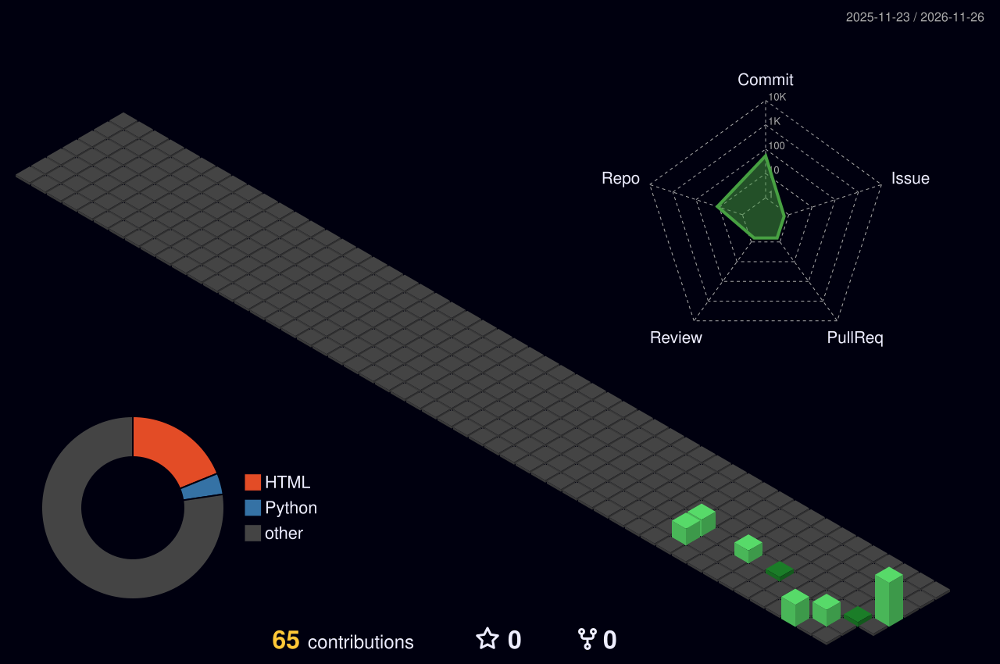

## Hi there 👋

Pessoal que veio atrás do **Github Stats:** a API provavelmente saiu do ar nesse período,
mas você pode adicionar a sua própria, seguindo esse [tutorial](https://github.com/anuraghazra/github-readme-stats/blob/master/readme.md#deploy-on-your-own-vercel-instance)

<div style="display: inline_block"><br>
  
  
  
  
  
  
  
</div>
<h2 align="center"></h2>

<p align="center">
  
</p>
  
  ##
 
<div> 
  <a href=""></a>
  <a href="" target="_blank"></a>
 	<a href="" target="_blank"></a>
 <a href="" target="_blank"></a> 
  <a href = "gustavo.rodrigueslimaoficial@gmail.com"></a>
  <a href="" target="_blank"></a> 
  
</div>

<div align="center">

# 


```bash
> System: ONLINE
> User: capitaldf
> Mode: MATRIX
> Status: ACCESS GRANTED
```

</div>
<h2 align="center"></h2>

<div align="center">


</div>

<h3 align="center"></h3>

<div align="center">


</div>




<h2 align="center"></h2>

<p align="center">
  
</p>


